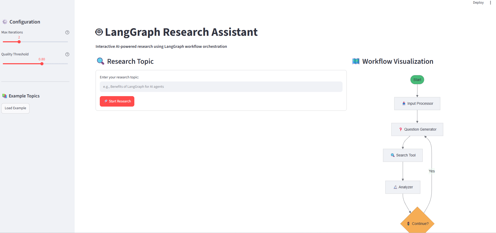

# LangGraph Research Assistant

A Python-based AI research assistant that uses **LangGraph** to coordinate topic refinement, question generation, DuckDuckGo search, findings analysis, iterative decision-making, and report generation. This repository also includes a **Streamlit interface** for interacting with the project.

## Streamlit Interface



> Screenshot: add a real screenshot of the running Streamlit application to `screenshots/streamlit-app.png` to display it here on GitHub.

## Features

- Refines a research topic using an LLM.
- Generates focused research questions.
- Retrieves results through DuckDuckGo search (`ddgs`).
- Extracts key findings from search snippets.
- Uses a LangGraph conditional edge to repeat research or generate a report.
- Produces a short report with a summary, findings, conclusion, and basic metadata.
- Demonstrates structured graph state with a `TypedDict`.

## Workflow

```text
START
  |
  v
Input Processor
  |
  v
Question Generator <----------+
  |                          |
  v                          |
DuckDuckGo Search             |
  |                          |
  v                          |
Analyzer                      |
  |                          |
  v                          |
Conditional Router -- Retry -+
  |
  | Finish
  v
Report Generator
  |
  v
END
```

**Note:** The code's `quality_score` is a simple count-based heuristic, not a measure of source reliability or factual accuracy. The graph stores findings in its invocation state; it does not implement persistent memory across sessions.

## Tech Stack

- Python
- LangGraph
- LangChain OpenAI integration (`langchain-openai`)
- DuckDuckGo Search (`ddgs`)
- Streamlit
- python-dotenv (optional, for local `.env` loading)

## Installation (Windows / VS Code)

```powershell
# Clone the repository
 git clone https://github.com/MernaMansour/LangGraph_RA.git
 cd LangGraph_RA

# Create and activate a Python 3.12 virtual environment
py -3.12 -m venv venv
.\venv\Scripts\Activate.ps1

# Install required dependencies
python -m pip install -r requirements.txt
```

If PowerShell blocks virtual environment activation, run `Set-ExecutionPolicy -Scope Process -ExecutionPolicy Bypass` and try again.


## Run the Project

Launch the Streamlit application:

```powershell
python -m streamlit run streamlit_app.py
```

Open `http://localhost:8501` in your browser.

To run the command-line research workflow, execute the Python file containing your LangGraph workflow (adjust the filename to match the file in this repository):

```powershell
python research_assistant.py
```

Stop the Streamlit server by pressing **Ctrl + C** in the terminal.

## Project Structure

```text
LangGraph_RA/
├── streamlit_app.py
├── research_assistant.py       # Rename to your actual workflow filename if different
├── requirements.txt
├── README.md
├── .gitignore
├── venv/
└── Streamlit_SS.png
```

## Limitations & Future Improvements

- Search snippets are not independently fact-checked.
- Add source URLs and inline citations to generated reports.
- Replace count-based quality scoring with source and evidence evaluation.
- Add persistent checkpointing if cross-session memory is required.

## Author

Merna Mansour
